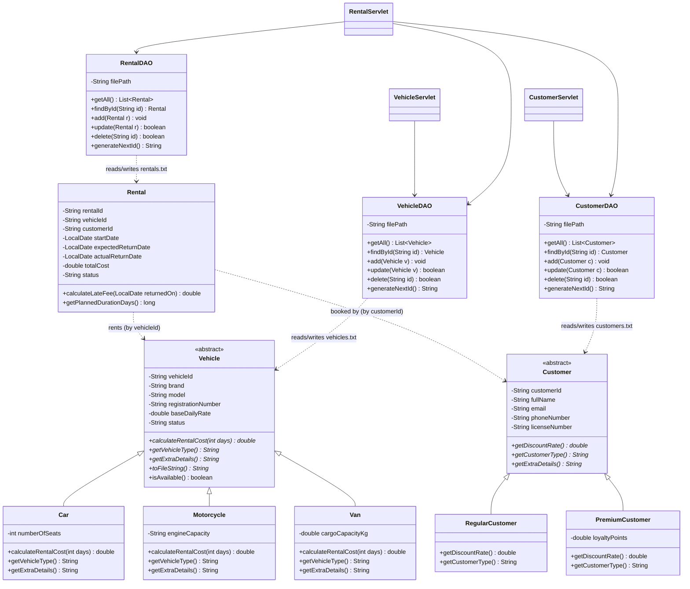

# Class Diagram — Vehicle Rental Service Platform

Paste the block below into the [Mermaid Live Editor](https://mermaid.live) to render
and export it as a PNG/SVG for your final report, or view it directly if your
Markdown viewer supports Mermaid (GitHub does, automatically).

## Quick explanation for the report / viva

- **Vehicle** and **Customer** are abstract superclasses — they can never be
  instantiated directly, only through a concrete subclass. This is
  **abstraction**.
- **Car, Motorcycle, Van** and **RegularCustomer, PremiumCustomer** each
  extend their abstract parent (**inheritance**) and provide their own
  version of the abstract methods (**polymorphism**) — e.g. calling
  `vehicle.calculateRentalCost(3)` runs different logic depending on whether
  `vehicle` actually holds a Car, Motorcycle or Van object at runtime.
- All fields in every model class are `private`, only reachable through
  public getters/setters, some of which validate input before accepting it
  (e.g. `Customer.setEmail()` rejects a string with no `@`). This is
  **encapsulation** and **information hiding**.
- The three **DAO** classes are the *only* classes that read or write the
  `.txt` files — every servlet goes through them instead of opening files
  itself, which is also information hiding, applied to the persistence layer.
- **Rental** is deliberately *not* part of either inheritance tree — it
  *has a* vehicle and a customer (composition by id reference), it *is not*
  a Vehicle or a Customer. This is a common point of confusion worth being
  able to explain in the viva.
